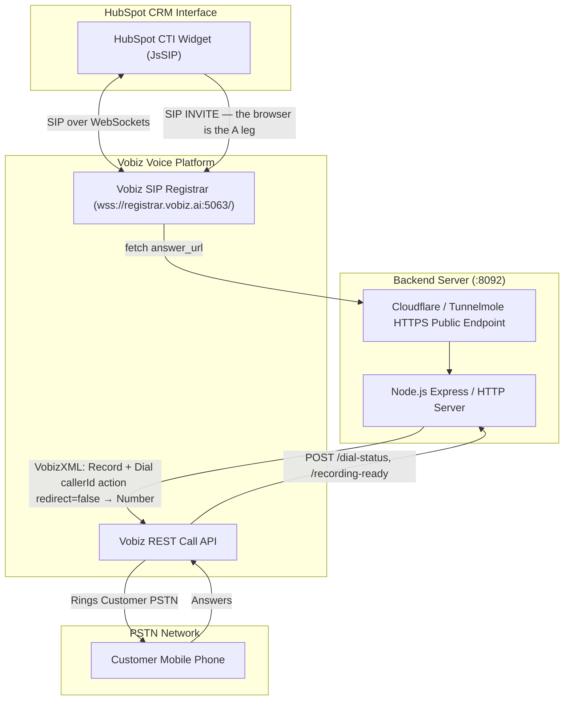

# Technical Architecture — Vobiz HubSpot Integration

This document describes the high-level architecture, communication protocols, and sequence flows for the **Vobiz Calling Integration for HubSpot CRM**.

---

## High-Level Architecture Components

---

## Core Operational Phases

### 1. Agent registration — any Vobiz account
The agent signs in with their own account's Auth ID and Auth Token; the backend
is not tied to any account. It verifies the pair against Vobiz, reads the
account's numbers (the caller-ID list), finds or creates this integration's
application in that account, then finds or creates **this agent's own Vobiz
endpoint** in that account (keyed on `authId:agentId`, persisted in
`backend/agent-endpoints.json` without any password or token), sets a fresh
random password on it, binds it to the application, and returns a session
token. The Auth Token stays in backend memory only.

SIP direct sign-in skips all of that: the browser registers with an existing
endpoint's typed credentials, and the backend records only SIP user → caller
ID. The
widget fetches its SIP identity from `GET /agent` with that token — and registers with
`wss://registrar.vobiz.ai:5063/` using `session_timers: false`, a space-free
`user_agent`, and STUN.

### 2. Outbound — the browser originates
The agent dials. **The widget sends the INVITE itself.** Vobiz fetches the
answer URL of the application the SIP endpoint is bound to, and the backend
returns `<Record recordSession>` followed by
`<Dial callerId … action … redirect="false"><Number>`.

`action` and `redirect="false"` are both required: without them Vobiz re-fetches
the answer URL when `<Dial>` ends and re-executes the document, so one call
dials the customer repeatedly.

### 3. Inbound — `<Dial><User>`
A PSTN caller reaches the DID attached to the application. `From` is a plain
number rather than a `sip:` URI, so the backend answers `<Dial><User>` naming
the registered endpoints of the account that owns the call (Vobiz's
`ParentAuthID`, or the dialled number when that is absent), and the widget
rings. Another account's agents are never rung. The number reaches this
application only after an agent clicks **Enable inbound calls**.

`callerId` is mandatory here. Omit it and Vobiz derives it from the A leg —
the *caller's* number, which the account does not own — so B-leg creation is
refused silently and the browser never rings.

### 4. Post-Call Engagement & CDR Logging
- Upon call termination, duration, timestamps, and call details are logged via `cti.callCompleted()`.
- HubSpot automatically attaches the call log engagement to the active contact record.
