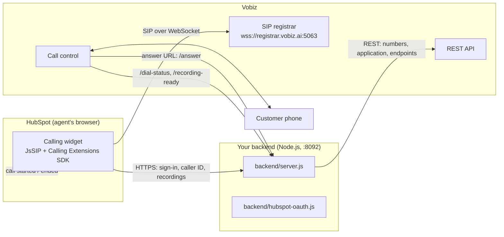

# Architecture

How the pieces of Vobiz Calling for HubSpot fit together, for developers who want to deploy, extend or
debug it. For setup, see the [setup guide](SETUP_GUIDE.md).

## Components



| Piece | Role |
| --- | --- |
| `source/` | The widget HubSpot loads in its calling panel: sign-in, dial pad, SIP stack (JsSIP), and the HubSpot Calling Extensions SDK messages that log calls. Built with `npm run build`. |
| `backend/server.js` | Serves the widget, signs agents in, sets up each Vobiz account, answers Vobiz webhooks, lists and streams recordings. Uses only Node.js built-in modules. |
| `backend/hubspot-oauth.js` | The HubSpot OAuth install (`/hubspot/install`, `/hubspot/callback`) and token storage. |
| `src/app/app-hsmeta.json`, `hsproject.json` | The HubSpot developer project uploaded with `npx hs project upload`. |
| `scripts/configure-calling.js` | Registers the widget URL with HubSpot's calling settings API and turns on inbound calling. |

## Sign-in

**Vobiz account.** The widget posts the Auth ID, Auth Token and an agent ID to `POST /login`. The agent
ID is `hs<HubSpot user id>`, so each HubSpot user is a separate agent. The backend:

1. Checks the credentials by listing the account's numbers.
2. Reads every page of numbers. Active, voice-enabled ones become the agent's allowed caller IDs.
3. Finds or creates the application `vobiz-hubspot-calling-integration` with answer and hangup URL
   `<PUBLIC_BASE>/answer`. An application is reused only if its answer URL is exactly that or its name is
   exactly that.
4. Finds or creates the agent's endpoint (alias `hubspot-<agentId>`), sets a new random password, and
   links it to the application.
5. Returns a session token. The widget sends it as `Authorization: Bearer <token>` on every later request
   and fetches its SIP credentials from `GET /agent`.

The Auth Token is kept in memory for that account. The agent → endpoint mapping is saved to
`agent-endpoints.json` without passwords.

**SIP direct.** The widget posts the SIP username and caller ID to `POST /login-sip`. The password stays
in the browser, which registers with it directly. The backend records only SIP username → caller ID.

## Outbound call

1. The agent dials. The widget tells HubSpot a call is starting (`outgoingCall`), and sends a SIP INVITE
   from the agent's endpoint to the number, with the chosen caller ID in an `X-VH-Caller-ID` header.
2. Vobiz fetches the endpoint's application answer URL, `/answer`.
3. The backend finds the agent from the SIP username, checks the caller ID is one of that agent's
   numbers, and returns:

   ```xml
   <Response>
     <Record fileFormat="mp3" recordSession="true" maxLength="3600" playBeep="false" redirect="false"
             callbackUrl="https://calling.example.com/recording-ready" callbackMethod="POST"/>
     <Dial callerId="+91XXXXXXXXXX" timeout="30" timeLimit="14400"
           action="https://calling.example.com/dial-status" method="POST" redirect="false">
       <Number>+91XXXXXXXXXX</Number>
     </Dial>
   </Response>
   ```

4. Vobiz rings the customer and bridges the call to the browser.
5. When the call ends, the widget tells HubSpot it ended and is complete (`callEnded`, `callCompleted`).
   HubSpot writes the call engagement to the contact's timeline.

A SIP username that belongs to no signed-in agent gets `<Hangup/>`.

## Inbound call

1. A customer calls a number that an agent attached with **Enable inbound calls** (`POST /setup-inbound`).
2. Vobiz fetches `/answer`. The backend identifies the Vobiz account from the webhook's `ParentAuthID`,
   or, if absent, from the dialled number.
3. It returns the same `<Record>` followed by a `<Dial>` with one `<User>` per signed-in agent of that
   account, and the dialled number as `callerId`. All agents ring at once; the first to answer takes the
   call. Agents of other Vobiz accounts never ring. SIP direct agents ring for their own caller-ID number.
4. If no agent is signed in, the caller hears a short message and the call ends.
5. The ringing widget shows the overlay and tells HubSpot about the incoming call (`incomingCall`).

## Recordings

Vobiz posts to `/recording-ready` when a recording can be downloaded. `GET /recordings` lists the
account's recent recordings, each with a playback link of the form
`/recording-audio/<id>?a=<authId>&exp=<expiry>&sig=<signature>`. The signature covers the account,
recording and expiry, using `SIGNING_SECRET`. The backend fetches the audio from Vobiz and streams it to
the browser.

## Backend routes

| Method | Path | Purpose |
| --- | --- | --- |
| GET, POST | `/answer` (also `/inbound-answer`) | Answer URL Vobiz calls for every call |
| POST | `/dial-status` | Result of `<Dial>` |
| POST | `/recording-ready` | Recording is available |
| POST | `/login` | Vobiz account sign-in |
| POST | `/login-sip` | SIP direct sign-in |
| POST | `/logout` | End the session |
| GET | `/session` | Current sign-in, used when the panel reloads |
| GET | `/agent` | This agent's SIP credentials |
| POST | `/select-number` | Change the caller ID |
| POST | `/setup-inbound` | **Enable inbound calls** for a number |
| GET | `/recordings`, `/cdrs` | The account's recent recordings and call records |
| GET | `/recording-audio/<id>` | Signed recording playback |
| GET | `/call-status/<callUuid>` | Whether a call is live |
| GET | `/hubspot/install`, `/hubspot/callback`, `/hubspot/status` | HubSpot OAuth install |
| GET | `/widget/` | The widget |
| GET | `/health` | Liveness and the configured public URL |

Every widget route except `/login`, `/login-sip`, `/session`, `/logout` and `/recording-audio` needs the
session token. Routes that use the Vobiz API return 403 for SIP direct sessions.

## State

| What | Where | Survives a restart |
| --- | --- | --- |
| Sessions, Auth Tokens, call and recording metadata | Memory | No |
| Agent → endpoint ID and SIP username | `<DATA_DIR>/agent-endpoints.json` (or `AGENT_ENDPOINT_STORE`) | Yes |
| HubSpot OAuth tokens | `<DATA_DIR>/hubspot-tokens.json` | Yes |

`DATA_DIR` defaults to `backend/data`, created mode 0700; each file is written atomically with mode
0600. Files an older version wrote directly into `backend/` are read until the next write.

Because state is in memory, run a single backend instance.
